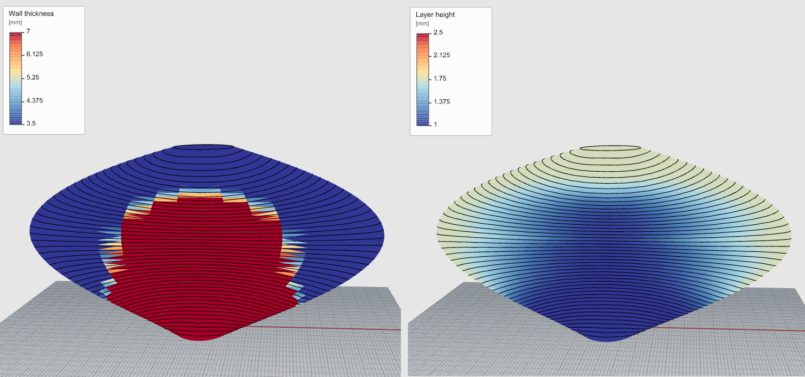

# ClayBESO — shell optimisation and non-planar layers for 3D printed clay

A Grasshopper plugin for Rhino 8 that:

1. **analyses** a thin clay shell (vase, vessel, column…) under **self-weight** and/or point
   loads with a built-in finite-element shell solver,
2. **optimises** it with **BESO**, either grading the **wall thickness** (no holes) or
   removing material to make **perforations**,
3. turns the optimised thickness into a **variable layer-height field** and slices the shell
   into **non-planar layer toolpaths**, with a **flow factor** at every point. Highly loaded
   regions get a wider bead and a taller layer, with the flow raised to supply both. For
   fixed-flow printers there are mappings where a thick wall comes from squashing the bead
   instead.

It also **scores** how printable a design is (1–100), can **pull overhangs back** to a printable
angle, and **plays the print back** bead by bead. For students there is one component that does it
all: **Clay Print** (see *Quick start*).

No other plugins or licences are needed.



*Left: the BESO wall thickness (3.5–7 mm) for a vase under self-weight. Clay is moved to the
lower body, which carries the weight. Right: the resulting target layer heights (1–2.5 mm) with
the non-planar layer toolpaths. This image uses the fixed-flow "constant bead area" mapping
(thick regions get lower, squashed layers). The default is now the proportional mapping, where
thick regions get taller layers and more flow.*

---

## Install

**Easiest:** download the `.yak` file from the
[latest release](https://github.com/swilcock0/ClayBESO/releases/latest) and **drag it onto an
open Rhino 8 window**. Then restart Rhino. To uninstall, use `_PackageManager` → Installed.

Manual install:

1. Install **Rhino 8**.
2. Get the built plugin, either:
   - from a colleague: the folder containing `ClayBeso.gha`, `ClayBeso.Core.dll` and `CSparse.dll`, or
   - by building it yourself (see `CONTRIBUTING.md`), then running
     `powershell -ExecutionPolicy Bypass -File scripts/install.ps1`.
3. Put **the whole folder** (not just the .gha) in
   `%APPDATA%\Grasshopper\Libraries\ClayBESO\`. In Grasshopper: *File → Special Folders →
   Components Folder*.
4. Restart Rhino. A **ClayBESO** tab appears in Grasshopper.

> If Windows blocked the downloaded files: right-click each DLL/GHA → Properties → *Unblock*.

## Quick start (students)

Use the **Clay Print** component (panel *0 Start*). It needs two things:

1. **Shape**: the mid-surface of your wall (the surface halfway through the wall), as a surface or
   mesh, standing on the build plate (its lowest point is the bed). Open at the top, no floor.
2. **Printer**: pick your printer and nozzle from the dropdown.

It then does everything else: clamps the base, optimises the wall thickness for the clay's own
weight, makes the non-planar layers, checks the finished piece and each stage of printing (strength
and buckling), and gives a **Score** from 1 to 100 with a **Report** saying what limits it and what
to change. Shape your design with sliders and watch the score.

- **Optimise** off = a uniform wall: faster while you are still shaping.
- **Fix Overhang** on = parts that lean too far are pulled back to a printable angle first. The
  corrected shape comes out of **Shape**.
- **Time**: a 0–1 slider plays the print back (right-click the slider → *Animate* for a video).
- **Layers** and **Flow Factor** are the toolpaths for your printer.

The score compares designs. Its limits are placeholders until the tests in `docs/VALIDATION.md`
calibrate them, so a high score is not a guarantee.

## Components

Every input and output of every component (type, default, units) is listed in
**[docs/COMPONENTS.md](docs/COMPONENTS.md)**.

| Tab | Component | What it does |
|---|---|---|
| 0 Start | **Clay Print** | Everything in one: shape + printer → optimised wall, layers, checks, a 1–100 printability score and playback. |
| 1 Model | **Fix Overhang** | Pulls overhanging parts of a vase back to a max lean (e.g. 45°), moving points only as far as needed. |
| 1 Model | **Material** | E [MPa], ν, density [kg/m³], optional strength [MPa]. Defaults = green clay; right-click for presets (Clay, Wood). |
| 1 Model | **Shell Model** | Mesh + material + thickness [mm] + supports (auto base) + loads → model. |
| 3 Optimise | **Shell BESO** | Live BESO loop (Run / Reset), thickness or void mode. Its **Design** output carries everything downstream. |
| 4 Print | **Print Layers** | Design → layer heights, non-planar layer toolpaths, flow factor and overhang check, in one step. |
| 2 Analyse | **Print Check** | Print → interlayer, stress, stage and buckling check of the finished piece and of the print in progress, and a 1–100 printability **Score** with a report. |
| 4 Print | **Print Playback** | Print → the beads laid down up to a moment of the print (Time slider 0–1), the nozzle and the print time. Animate the slider for a video. |
| 4 Print | **Layer Rule** | Optional: how thickness becomes layer height. Give the same rule to BESO and it travels on in the Design. |
| 2 Analyse | **Shell Analysis** | Optional: stress, displacement, force-flow lines and (Buckling on) the buckling factor and shape of the starting shell (connect Shell Model) or the optimised one (connect BESO's Design). |
| 4 Print | **Wall Preview** | Optional: thickened solid wall for visual checking. |
| 5 Help | **Help** | Double-click to open the component reference; shows the installed version. |

Every option input (BESO mode, layer method, mapping, what to show) gets a **dropdown** of named
choices automatically when you place the component.

The most important inputs and outputs sit at the top of each component, with full-word labels.
Older components (Layer Heights, Non-planar Layers, Interlayer Check, Print Stages, and the earlier
versions of Shell BESO and Shell Analysis with a different input order) are hidden from the toolbar
but still load with their wiring intact, so existing definitions keep working. Print Layers and Print Check do
the same jobs with fewer connections.

## Basic workflow

One straight chain, no wires going back up the canvas:

```
Mesh ──► Shell Model ◄── Material
              │
              ▼
         Shell BESO ◄── Layer Rule (optional)        Run = Boolean Toggle
              │ Design (model + thickness + rule + bond)
              ▼
         Print Layers   Method: Conforming / Eikonal / Force-aligned (dropdown)
              │ Layers, Flow Factor, Realised Height, Width, Overhang Ratio ...► your toolpath / G-code
              │ Print
              ▼
         Print Check    Show: utilisation / interface angle / stress / displacement / contact
              │         Stage: finished piece / worst print stage / any stage
              │ Check (optional)
              ▼
         Print Playback ◄── Time slider 0–1  (also takes Print directly from Print Layers)
```

A working example is in **`examples/TestVase.ghx`**. It builds a parametric vase from ellipses
with sliders and needs no Rhino geometry: open it in Grasshopper and set BESO's *Run* toggle to
true.

1. **Mesh the mid-surface** of the wall (the surface halfway through the wall thickness). Aim for
   2 000–20 000 faces with roughly even triangles or quads; finer meshes are more accurate. The
   bottom edge should sit on the build plate (lowest Z).
2. **Shell Model**: give the starting thickness (e.g. 5 mm). This is your **clay budget**: by
   default BESO keeps this amount of clay and only moves it around. *Fix Base* clamps everything
   at the lowest Z. Keep *Self-weight* on. Add point loads if needed (vectors in N).
3. **Shell BESO**: set **tMin / tMax** to the thinnest and thickest wall you can print. The
   starting thickness must lie between them, ideally near the middle. Leave **Filter Radius** at 0
   (automatic: 3 mesh edge lengths, shown in *Info*), or set a larger one for smoother, more gradual
   walls. Then switch **Run** on. *Converged* turns true when it's done;
   **Reset** starts again.
   - Leave **Volume Fraction** at 0 to redistribute the same clay (the usual case). Above 0 it
     changes the amount: the average wall becomes Vf × tMax. Void mode always needs one.
   - Connect a **Layer Rule** to optimise a wall that is weaker across its layers (see *Printed
     layers inside the optimisation*). The rule then travels on in the Design output.
   - **Playback**: a 0–1 slider scrubs through the iterations (1 = final). The Design output
     follows it, so everything downstream updates too.
4. **Print Layers**: connect BESO's **Design**. Pick the **Method**:
   - *Conforming*: every layer is a closed loop and the last one is the rim; heights matched as
     closely as the geometry allows.
   - *Eikonal*: heights matched exactly, but the top may end in partial layers.
   - *Force-aligned*: like Conforming, but the layers turn to lie across the force flow so the
     interfaces are compressed rather than sheared. The force flow is computed inside; there's
     nothing to wire.

   Layer heights come from the Layer Rule (BESO's, a rule connected here, or the default:
   proportional, 1–2.25 mm). The outputs per path point are the **Flow Factor** (multiply your
   nominal extrusion by it), **Realised Height**, **Width**, **Overhang Ratio** and **Layer
   Tilt**, plus more at the bottom. *Show* picks the preview: layer height, height error, wall
   thickness or wall lean. *Info* lists the flow range and any printability warnings.

   With flow control (e.g. the WASP 40100), both bead width and layer height follow the design
   and the flow factor supplies the clay. The flow factor uses the *realised* layer height, so
   the wall comes out at the optimised thickness even where layers can't hit the target height.
   Structurally, the clay per unit of wall area is set by the **thickness**; a taller layer puts
   more clay down per pass and gives fewer layers.
5. **Print Check**: connect **Print**, and give a clay **Strength** (here or on Material).
   It checks the finished piece under all loads and the print at N stages under self-weight, and
   reports the highest interlayer utilisation and the worst stage. *Show* and *Stage* choose what
   the preview colours and when; *Flow Lines* draws the force flow. **Score** (1–100) and
   **Score Report** sum it up (see *Printability score*).

6. **Print Playback** (optional): connect **Print** and a 0–1 **Time** slider. It shows the beads printed
   up to that moment (each as wide as the wall and as tall as its layer, with rounded sides), the
   nozzle, the layer being printed and the print time at *Speed* (25 mm/s by default; printing only, no
   travel or pauses). *Colour* picks layer, flow factor, layer height, bead width or wall lean. Connect
   Print Check's **Check** output to read, at each moment, the buckling factor and interlayer
   utilisation of the stage printed so far. Right-click the slider > *Animate* to export a video.

**Layer Rule mappings** (dropdown on the Layer Rule):
- *Proportional* (default): thinnest wall → hMin, thickest → hMax. Set **Thickness Range** to BESO's
  tMin–tMax (BESO does this automatically for the rule it passes on).
- *Constant aspect ratio* (h = k·t): rises with thickness, same bead shape everywhere.
- *Constant bead area* and *Linear inverse*: for printers without flow control, where a thicker
  wall can only come from a lower, more squashed layer.

## Printability score

Print Check and Clay Print give a score from 1 to 100. Each aspect gets its own 0–100 score, from 100
at a comfortable value to 0 at a failing one:

| Aspect | 100 at | 0 at |
|---|---|---|
| Overhang (wall lean, 95 % of the wall) | max lean − 15° | max lean + 10° |
| Bead support (beads more than half past the one below) | 0 % | 5 % |
| Nozzle tilt (path steeper than max tilt) | 0 % | 5 % |
| Layer contact (layers taller than 0.8 × the wall) | 0 % | 10 % |
| Layer heights (mean error from target) | 5 % | 30 % |
| Closed layers (partial layers) | 0 % | 25 % |
| Buckling (lowest factor, finished or any stage) | 6 | 1 |
| Layer bond (interlayer utilisation, needs a strength) | 50 % | 100 % |

The total is the geometric mean of the aspects, so improving anything raises it but one weak aspect
pulls it down hard. If any aspect fails (below 10), the total is capped at 25. The Report lists the
aspects weakest first with what to change. The limits are placeholders until calibrated with
`docs/VALIDATION.md`: use the score to compare designs, not as a guarantee.

## Printer settings (Delta WASP 40100 Clay, 1.5–3 mm nozzles)

Build volume Ø400 × 1000 mm. Rules of thumb for a single-bead wall. Calibrate them with a
test print for your clay body. Layer heights follow the 25–75 % of nozzle diameter range from
Vele, Kurilla & Achten (eCAADe 2023):

| Nozzle | tMin – tMax (bead width) | hMin – hMax (layer height) | aspect k |
|---|---|---|---|
| 1.5 mm | 1.8 – 3.5 mm | 0.4 – 1.1 mm | 0.35–0.45 |
| 2.0 mm | 2.4 – 4.6 mm | 0.5 – 1.5 mm | 0.35–0.45 |
| 3.0 mm | 3.5 – 7.0 mm | 0.75 – 2.25 mm | 0.35–0.45 |

The component defaults are set for a 3 mm nozzle. Keep the **flow factor** range within what
your extruder can follow quickly. Compare the min–max shown in the *Info* output against what
you see in a test print.

**Walls thicker than one bead.** The tMax values above assume a single straight bead. Paths that
move back and forth within each layer can build much wider walls from the same nozzle. For
example, WeaveSlicer (Friedman-Gerlicz et al., CHI 2024) uses a sinusoidal path whose amplitude
sets the wall thickness, with reported walls of 2–20 mm. If you plan such paths, you can give
BESO a larger tMax and use its thickness field to drive the oscillation. ClayBESO doesn't
generate these paths itself: the thickness field and the layer curves are the inputs for your
own path design.

## Colours and legends

Every component with a coloured preview draws a **legend** (colour bar with values) in the top
left of the Rhino viewports. Turn it off with the *Legend* input, or hide the component's
preview. When several are visible they sit side by side. Blue is low and red is high.

The **Colour Range** input fixes the scale. Values outside the range get the end colours.
Defaults when nothing is connected:

| Component | Shows | Default range |
|---|---|---|
| Shell BESO | wall thickness [mm] | tMin–tMax (void mode: min–max) |
| Print Layers | layer height / height error / thickness / wall lean | hMin–hMax / symmetric / min–max / 0–90° |
| Print Check | utilisation / interface angle / stress / displacement / contact | 0–max (≥ 1) / 0–90° / min–max / min–max / 0–1 |
| Shell Analysis | von Mises stress [MPa] or displacement [mm] | min–max of the result |

Fix the range to compare runs. With an automatic range, a tiny variation fills the whole
blue-to-red scale.

## Layer interfaces (layer height in the structure)

The shell analysis treats the wall as solid. Printed clay is weakest **between layers**: a bead of
width w and height h has rounded sides, so it bonds to the next layer over a flat strip only about
w − h wide. **Print Check** accounts for this:

1. It takes the wall thickness (bead width w) and the printed layers from the Print. The realised
   layer height h and the stacking direction, which follows the real non-planar layers, come from
   the layer field.
2. It rotates the stresses into the layer directions and puts the across-layer force and moment
   through the bonded strip only, a fraction **c = (w − h)/w** of the wall.
3. It reports a **utilisation**, the worst of
   - **bond**: tension + shear on the strip vs **η·f**, and
   - **bearing**: compression on the narrowed strip vs **f**, which matters for wet clay carrying
     its own weight.

Inputs: clay **strength f** (or set it on Material) and **bond efficiency η**, the interface
strength per unit contact area relative to the bulk clay. Leave η at 0 to use the design's (or 1),
then calibrate it from tests (`docs/VALIDATION.md` §4). With *Orthotropic* on (the default), the
wall is also weaker across its layers, so stresses redistribute as they would in the print. On a
6 mm wall, going from 1 mm to 3 mm layers raises the peak utilisation about 2.7× in the test case.

## Printed layers inside the optimisation

Connect a **Layer Rule** to Shell BESO and it optimises a wall that is weaker across its layers:
across-layer stiffness × **κ = η · (t − h(t))/t**, the same bond model Print Check uses, with h(t)
from the rule. BESO resolves the rule (its Thickness Range becomes tMin–tMax) and passes it on in
the **Design**, so Print Layers prints the layer heights BESO assumed.

- Inside BESO the layers are taken as horizontal; Print Check uses the real non-planar layers.
- With the proportional mapping, h grows with t, so c stays roughly constant and κ is a
  near-uniform across-layer weakening (η × 0.68–0.71 with the defaults). That still changes where
  BESO puts clay: in the test case the layer-aware design is about 2% stiffer than the layer-naive
  one when both are judged with layers. Mappings where h does not follow t (e.g. constant bead
  area) make κ vary with thickness, and BESO then trades layer contact against wall thickness.
- Shell BESO's Info shows the rule, η and the κ range.

## Overhangs, force flow and print stages

These follow two studies of non-planar clay printing by Vele, Kurilla & Achten (eCAADe 2023) and
Vele & Achten (DARE 2023). Planar clay prints started to slump at about 45° of overhang and failed
above 55°, while non-planar layers reached 70–80°. The weak point is the layer interface: on an
overhang it is loaded in shear and layers slide.

- **Overhang check** (Print Layers, always on). At every path point:
  - **Wall Lean**: how far the wall leans from vertical, across the bead.
  - **Bead Offset** = realised layer height × tan(lean): how far the bead sits past the one below.
  - **Overhang Ratio** = offset ÷ bead width: the unsupported fraction of the bead.
  - **Layer Tilt**: the layer's slope along the path. The WASP 40100 can't tilt its nozzle, so steep
    tilts scrape the clay, which is one of the failures Vele & Achten saw.

  Points beyond **Max Overhang** (default 45°), a ratio of 0.5, or **Max Tilt** (default 30°) are
  counted in *Info* and raise warnings. Lower layers over an overhang reduce the bead offset; this
  is why condensed non-planar layers help.
- **Force flow and interface angle** (Print Check; Shell Analysis for the starting shell). The force
  flow is the direction of the dominant in-plane force on each face; *Flow Lines* draws it. The
  **interface angle** is the angle between the force and the stacking direction. 0° means the force
  crosses the layers squarely (interfaces in compression); 90° means it runs along them
  (interfaces in shear).
- **Force-aligned layers** (Print Layers, Method *Force-aligned*). The layers turn to lie across the
  force, by at most **Max Deviation** (default 30°), and every layer stays a closed loop. Print
  Layers computes the force flow itself. In a test cylinder pushed sideways at the rim, the
  force-weighted interface angle dropped from 26° to 18°. Under pure self-weight the force is
  vertical and the layers stay planar. Turning closed layers pulls them apart in places, so the
  turn gives way wherever a layer would get taller than the Layer Rule's **Max Layer Height**.
  *Info* says how much of the turn was kept. If it's little, the targets are already at Max Layer
  Height there: raise it (within 75 % of the nozzle) or use shorter target layers.
- **Bead contact** (Print Layers). A layer as tall as the wall is wide barely touches the one
  below. Points with layers taller than 0.8 × the wall (contact under 20 %) get a warning; Print
  Check's interlayer utilisation will be high there.
- **Print stages** (Print Check). Overhangs fail *during* printing. Print Check analyses the piece
  at N stages, each with only the layers printed so far loaded by their own weight, and picks out
  the worst one (*Stage* dropdown → *Worst print stage* to see it). Clay stiffness is taken as the
  same at every height for now.

The tests to calibrate Max Overhang and Max Tilt for your clay and printer are in
`docs/VALIDATION.md` §7.

## Buckling

Wet clay walls usually fail by **buckling** (folding sideways) before the clay is over-stressed.
Print Check runs a linear buckling analysis of the finished piece and of every print stage
(**Buckling** input, on by default); Shell Analysis does it when you turn **Buckling** on.

- **Buckling Factor**: how many times its loads the shell carries before it buckles. Print Check
  gives the lowest one, finished piece or any stage; **Stage Buckling** lists it per stage (for a
  stage, how many times heavier the clay could be before that stage folds). Below 1 = buckles.
- **Show → Buckling mode** draws the buckling shape. Its size is arbitrary: with Deform Scale 10
  the largest movement is drawn at 5 % of the model size.
- The analysis assumes a **perfect** shape. Real walls buckle well below it, so the plugin flags
  factors below 3 as at risk. That margin is a placeholder: measure your clay's knock-down with
  the collapse-height test in `docs/VALIDATION.md` §5.
- A thicker or more curved wall, a stiffer (drier) clay, or a lower print raise the factor. A thicker
  wall raises it most: bending stiffness grows with t³.

## Units

Geometry is read in the **Rhino document units** and converted internally. **Thickness, layer
height and bead width are always in millimetres**, forces in **newtons**, stresses in **MPa**.

## Choosing material values

| State | E [MPa] | density [kg/m³] | notes |
|---|---|---|---|
| Green / wet (printing) | 0.1–5 | 1800–2000 | governs collapse while printing |
| Leather hard | 10–50 | ~1900 | |
| Fired | 10 000–30 000 | 2000–2400 | |

**Strength** (Material, default **0.03 MPa**) is a cautious placeholder for soft printing clay.
Printing clays read about 0.6–1.3 kg/cm² on a pocket penetrometer (Friedman-Gerlicz et al. 2024),
which is an unconfined compressive strength of 0.06–0.13 MPa. Interfaces fail in shear and tension,
which are weaker, so the default is about half the softer value. Measure your own clay: reading
[kg/cm²] × 0.098 = MPa, then halve it (`docs/VALIDATION.md` §2). Until you do, read utilisation as
relative (where is worst, which design is better), not absolute. Green-clay strength changes a lot
with water content and drying time.

For a **stiffness** optimisation the absolute value of E only scales the displacements. The
optimised *shape* does not depend on it. It matters for checking deflections and stresses.

## Limitations — read before trusting results

- Linear elastic, small-displacement analysis. Print stages are analysed separately, but the clay
  is equally stiff at every height (no ageing). **Buckling** is a linear (perfect-shape) prediction:
  real walls fold below it, see *Buckling* above.
- Flat triangular elements converge from the stiff side on curved shells. Use fine meshes
  (≥ 40 divisions around a vase).
- Void mode may stop at the iteration limit without converging. Holes interrupt continuous
  layers, so check printability. If a point load ends up on a hole, keep the faces around it
  solid (Shell Model *Frozen Faces* input).
- No G-code output yet. The plugin gives you polylines with per-point heights and flow factors.

See `docs/THEORY.md` for the maths and references, `docs/VALIDATION.md` for the experimental validation plan,
`tools/KarambaCheck/README.md` for the comparison with Karamba3D, `CONTRIBUTING.md` to work on the code, and
`AGENTS.md` for the rules AI assistants follow in this repo.
