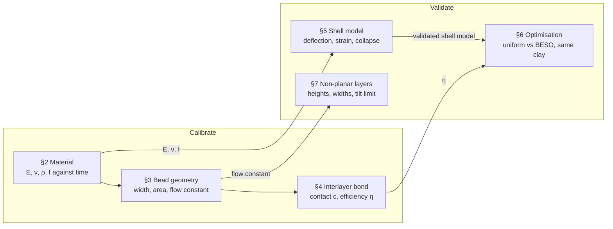

# ClayBESO — Experimental Validation Plan

ClayBESO's outputs rest on seven modelling assumptions. Each needs test evidence before it
informs a printed design. This plan lists the tests, the plugin input each one sets or checks,
and the result that counts as a pass. Calibration tests (sections 2–4) come first, because their
numbers feed the validation tests (sections 5–7).

## 1. Purpose and scope

| # | Assumption in the plugin | Plugin input or output it affects | Tested in |
| --- | --- | --- | --- |
| 1 | Green clay is linear elastic with known E, ν and density | Clay Material (E, ν, ρ) | §2 |
| 2 | One clay strength f describes failure | Clay Material (Strength), Interlayer Check (f) | §2 |
| 3 | A bead of width w and height h has a stadium cross-section, and flow per mm of path = its area | Layer Heights, Non-planar Layers (Bead Area, Flow Factor) | §3 |
| 4 | Layers bond over a strip c = (w − h)/w wide, with efficiency η | Interlayer Check (η, cMin); BESO interlayer stiffness | §4 |
| 5 | The shell FE model predicts deflection and stress of the finished shell | Shell Analysis | §5 |
| 6 | A BESO-graded wall is stiffer than a uniform wall with the same clay | Shell BESO | §6 |
| 7 | Printed non-planar layers follow the realised layer heights | Non-planar Layers (Realised Height) | §7 |

Out of scope here: drying and firing shrinkage, creep, and stability during printing (the plugin
analyses only the finished geometry). Buckling of wet walls is a known gap; §5 records collapse
heights so a future buckling check can be validated against them.

Every result feeds back into the repo: measured values become component defaults or documented
ranges in the README, and raw data goes in `docs/validation/` with the plugin version (git tag)
used.

## 2. Material characterisation (green clay)

Measure E, ν, density and strength f of the clay at its printing water content. They set the
Clay Material component. Green clay stiffens as it dries, so every value is recorded with the
time since extrusion.

| Parameter | Test | Specimen | Plugin input |
| --- | --- | --- | --- |
| Water content | Oven drying at 105 °C (ASTM D2216) | 3 samples per clay batch | Recorded with every test |
| Density ρ [kg/m³] | Mass of a known volume | Filled cylinder mould, 3 per batch | Clay Material ρ |
| Young's modulus E [MPa] | Unconfined compression (ASTM D2166), about 1 %/min | Cylinders of the printing batch, height = 2 × diameter (e.g. 38 × 76 mm) | Clay Material E |
| Poisson's ratio ν | Lateral strain in the same test, by DIC or video | Same cylinders | Clay Material ν |
| Strength f [MPa] | Peak stress, or the stress at 15 % strain if there is no peak | Same cylinders | Clay Material Strength; Interlayer Check f |
| Quick batch check | Pocket penetrometer or vane | 5 readings per batch | Correlated with E, for batches without a full test |

- **E** = secant modulus to 1 % strain; also report the initial tangent.
- **Time:** test at 0, 30, 60 and 120 min after extrusion. Use E and f at the time the critical
  region is loaded in print (from print time per layer).
- **ν:** if lateral strain can't be measured reliably, keep 0.35–0.45 and run the plugin at both
  ends to show the effect.
- **Replicates:** at least 3 per condition. Pass: coefficient of variation ≤ 15 % for E and f.
- **Into the model:** mean E; the lower 5 % value of f for checks.

For the fired-state tests in §5, repeat E and f on fired bars in three-point bending (at least 5
bars).

## 3. Bead and layer geometry (WASP 40100)

Check that the printer lays down the bead the plugin asks for. Bead width should equal the wall
thickness t, height the layer height h, and the cross-section should match the stadium area
A_b = (w − h)h + πh²/4 that sets the Flow Factor. This section also calibrates the flow factor
into machine units.

1. **Straight-wall matrix.** Print single-bead walls 150 mm long and 30 layers high at fixed feed.
    - Nozzles: 1.5 and 3 mm.
    - h = 0.25, 0.5 and 0.75 × nozzle (the printable range in Vele, Kurilla & Achten 2023).
    - Flow factor F = 0.6, 0.8, 1.0, 1.2, 1.5 and 2.0.
    - Measure: bead width with calipers at 5 points on 5 layers; layer height from total height ÷
      layer count; cross-section area from a photographed cut through the wall.
2. **Volumetric calibration.** Plot measured area × feed against the commanded extrusion. The
   slope is the machine constant (mm³ of clay per extrusion unit) that turns the plugin's Bead
   Area into G-code values.
3. **Response to flow changes.** Print one wall with a step change in F halfway along, and one with
   F rising linearly. Measure the length over which the width settles. This sets how sharply the
   thickness field can vary along a path (the smoothing passes in Layer Heights). Also measure
   the **lead**: the path length by which a flow change must be sent early so the width changes at
   the right place. Vele & Achten (2023) found ram extruders need the flow changed "slightly in
   advance", and combined flow and speed changes for very low or very tall layers.

Pass criteria:

- Width within ±10 % of the target over the usable F range.
- Measured area within ±10 % of the stadium model. A consistent bias is taken into the plugin as a
  correction factor.
- The flow-factor range the extruder follows within one step length is written into the README as
  the printable range.

## 4. Interlayer bond

The contact fraction c = (w − h)/w is an assumption, and the bond efficiency η is unknown. These
tests measure the real contact width and interface strength across layer heights, then fit η. If
η comes out roughly constant across h/w, the model holds. If it trends with h/w, the contact law
needs replacing with the measured curve.

**Variables:** h/w = 0.25, 0.40, 0.55 and 0.70 on a 3 mm nozzle with w about 5 mm. Keep feed and
the time between layers fixed and recorded, because bond also depends on how wet the layer below
still is.

1. **Contact width.** Cut printed walls across the layers at leather-hard and after firing.
   Photograph with a scale and measure the fused width at 10 interfaces per wall. Compare with
   w − h.
2. **Bond in tension.** Cut wall strips 25 mm wide.
    - *Across layers:* bend the strip in three-point bending with the layers vertical, so the
      interfaces open at mid-span.
    - *Along layers:* the same test with the layers horizontal.
    - *Solid reference:* moulded bars of the same clay.
3. **Bond in shear.** Direct shear on two-layer specimens, or on a single interface of a short
   printed wall.
4. **Bearing.** Compress short printed columns (10 layers) and moulded cylinders of the same
   section. This checks the compression term f/c used in the Interlayer Check.

Compute η from the across-layer failure stress on the full section, σ_gross:

```
η = σ_gross / (c · f)
```

Use at least 5 specimens per h/w for each of tests 2–4. Test green-state specimens at the same
time after printing as in §2, and fired specimens for §5.

Pass criteria:

- Measured contact width within ±20 % of w − h, or a fitted law that replaces it.
- η has a coefficient of variation ≤ 20 % across all h/w. The mean η becomes the Interlayer Check
  default and is used in BESO's interlayer stiffness.
- Across-layer strength below along-layer strength, which confirms the anisotropy that BESO's
  interlayer stiffness models.

## 5. Shell model validation

Compare Shell Analysis predictions with measurements on printed shells. Use the E, ν and f from §2
for the matching clay state. Fired shells give the cleanest check, because fired clay is close to
linear elastic. Green shells check the self-weight case the optimiser is built for.

**Specimens:** a straight cylinder (Ø150 × 200 mm), a cone at 60° wall angle, and the reference
vase from `examples/TestVase.ghx`. All have 5 mm walls and 3 replicates.

1. **Fired, lateral rim load.** Clamp the foot in a plaster bed. Load the rim horizontally in 5
   steps with a load cell and a displacement transducer. Fit two strain gauges where Shell
   Analysis predicts the highest stress and one in a low-stress region. Load to failure on the
   last specimen of each shape.
2. **Green, self-weight.** Scan each shell (photogrammetry or a structured-light scanner) right
   after printing and again after 30 and 60 min. Compare the sag and ovalisation with the Shell
   Analysis displacement field. Repeat at two print heights.
3. **Collapse height (for the buckling gap).** Print the cylinder taller until it collapses, 3
   times. Record the height and failure mode. No plugin check exists yet; these numbers are the
   target for a future buckling check.
4. **Mesh check.** Run every specimen at 3 mesh densities and report the spread. The flat elements
   are slightly stiff on coarse meshes, so state the mesh used beside each comparison.

Pass criteria:

- Fired rim stiffness (load ÷ displacement) within ±15 % of the prediction.
- Strain at the gauges within ±20 %.
- Failure starts within 20 mm of the predicted peak-stress or peak-interlayer-utilisation point.
- Green self-weight displacements within ±30 %, given the scatter of green E. Record the time
  dependence rather than tuning E to fit.

## 6. Optimisation validation

Test the plugin's main claim: for the same amount of clay, a BESO-graded wall is stiffer and
stronger than a uniform one. Write down the plugin's predictions before any specimen is tested,
so the comparison is blind.

| Variant | Wall | Clay |
| --- | --- | --- |
| A, uniform | 5 mm everywhere | Reference mass |
| B, BESO | Graded 3.5–7 mm, thickness mode, default settings | Same mass ±3 % (weigh each print) |
| C, BESO with interlayer stiffness | As B, with the Layer Rule and the calibrated η | Same mass ±3 % |

Use the reference vase geometry, 3 replicates per variant, the same clay batch and the same print
settings apart from the wall.

1. **Predictions (before testing).** From the plugin, record per variant: compliance, peak
   displacement, peak von Mises, peak interlayer utilisation and where it is. Record the predicted
   ratio B/A for each.
2. **Fired, lateral rim load.** As §5 test 1: stiffness and failure load.
3. **Green, self-weight.** As §5 test 2: sag after 30 min.
4. **Collapse height.** Print a taller version of each variant until it collapses. This is closest
   to how clay prints fail.

Pass criteria:

- B is stiffer than A in the fired test, with the difference larger than the spread of the
  replicates.
- The measured stiffness ratio B/A is within ±25 % of the predicted ratio.
- C performs at least as well as B where interlayer failure governs; otherwise report the
  difference as a limit of the bond model.

## 7. Non-planar layers

Check that printed layers follow the plugin's layer field: their heights, widths and tilt, and how
far the field can vary before printing fails. The toolpaths come from the student's own path
design, so the same test also validates that design.

1. **Realised heights.** Print the reference vase with the proportional mapping (1–2.25 mm layers).
   Scan it and measure the layer height around the circumference at 8 angles and 5 heights, by
   counting layer lines in the scan. Compare with the Realised Height output at the same points.
2. **Width.** Cut the vase at 3 heights after firing. Measure the wall thickness at 8 angles and
   compare with the BESO thickness there.
3. **Tilt limit.** Print rings whose layer height varies around the loop, from 1:1 up to 1:3
   (min:max) in steps. Record the ratio at which beads slip, drag or separate. That ratio becomes
   a warning threshold in Non-planar Layers.
4. **Methods.** Print the same vase with the Conforming, Eikonal and Force-aligned methods. Compare
   rim quality, the partial top layers and how far the force-aligned layers depart from planar.
5. **Overhang series** (after Vele & Achten 2023). Print vase-like pieces with symmetric overhangs
   from 10° to 80° in 5° steps, each sliced planar and with force-aligned non-planar layers (same
   layer count and clay). Record the overhang at which layers start to slump and the one at which
   the print collapses, for each slicing. Their clay on a 4 mm delta printer started deforming at
   45° and failed above 55° planar, and reached 70–80° non-planar. The planar limit becomes the
   **Max Overhang** default in Non-planar Layers, and the bead offset ratio at failure the
   overhang-ratio warning. Watch for their two non-planar failure modes: nozzle scraping on steep
   layer tilts (3-axis printer), and tipping from one-sided heavy top layers.
6. **Print stages.** For the reference vase and the overhang pieces, compare the stage the Print
   Stages component predicts as worst with the height at which deformation was first seen.

Pass criteria:

- Layer height within ±15 % of Realised Height.
- Fired wall thickness within ±15 % of the BESO thickness (allowing for the measured firing
  shrinkage).
- No collapse or bead separation within the tilt limit found in test 3.
- The Non-planar Layers overhang warnings flag every piece in test 5 that slumped, and no more than
  one size class beyond it.

## 8. Test sequence, equipment and records

Run the calibration tests first. Their numbers go into the plugin before any validation test is
predicted.



The optimisation test (§6) comes last, because it needs both the calibrated bond (η) and a shell
model that has passed §5.

| § | Test | Specimens (min.) | Equipment | Sets or checks |
| --- | --- | --- | --- | --- |
| 2 | Water content, density, unconfined compression | 3 per batch × 4 times | Oven, balance, universal testing machine (UTM) with a 100 N–1 kN load cell, camera or DIC | Clay Material E, ν, ρ, f |
| 3 | Straight walls, flow step | 36 walls + 2 | WASP 40100, calipers, camera | Flow constant, printable flow range |
| 4 | Contact cuts, bending, shear, bearing | 5 per h/w × 4 × 4 tests | Saw, camera, UTM | η, contact law |
| 5 | Rim load, self-weight scans, collapse height | 3 per shape × 3 shapes | UTM or load frame, transducer, strain gauges, 3D scanner | Shell Analysis |
| 6 | Uniform vs BESO pairs | 3 per variant × 3 | As §5 | Shell BESO |
| 7 | Layer scans, cuts, tilt rings | 1 vase × 2 methods + rings | 3D scanner, saw | Non-planar Layers |

**Record with every specimen:** clay batch and water content; room temperature and humidity; time
from extrusion to test; nozzle, feed, layer height and flow factor; the ClayBESO version (git tag)
and the `.gh` file used; and photographs before and after testing.

**Storage:** one CSV per test in `docs/validation/` in the repository, with a short note per
series. The plugin predictions for §5–7 go in the same folder, dated before the test.
